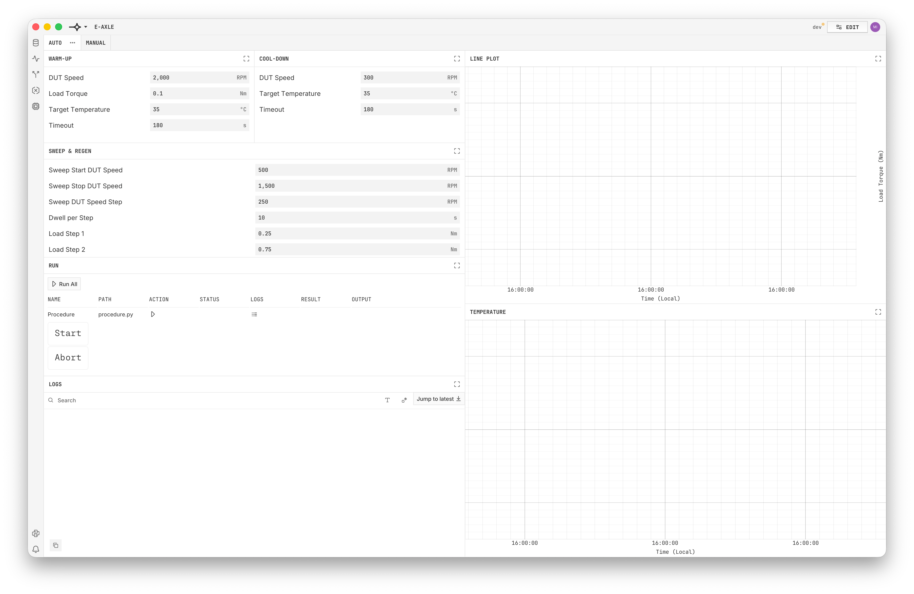
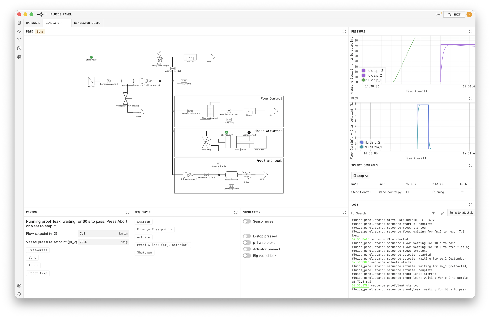

# demonstration-test-stands
Supporting code for Nominal office demonstration test stands. Each stand is its own
Python package with a Nominal Connect app in `app/`.

## [`e-axle`](e-axle/)

A command and control Connect application for an electric axle dynamometer, used to
test custom setpoint controls and automated procedures.

## [`fluids`](fluids/)

A simulation and hardware command and control application for a pneumatic fluids
panel, with a Connect app frontend that runs specialized testing procedures.

## Development

Uses `just` and `uv`. From the root, `just all` checks, lints, formats and tests both
packages. `just e-axle <recipe>` or `just fluids <recipe>` targets just one of them.
